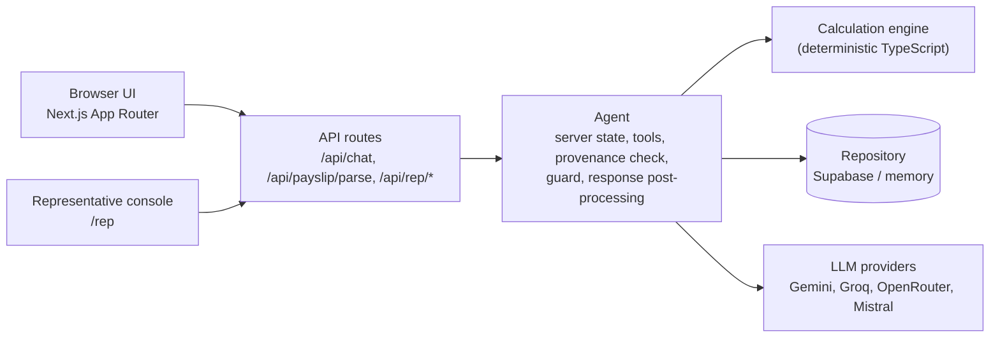

# NetWise

**תקציר בעברית:** NetWise הוא יועץ צ'אט בעברית (RTL) לעובדי שטראוס, שעונה כיצד מעבר לרכב חשמלי, לרכב אחר או ויתור על הרכב משנה את השכר הנטו החודשי.
החישוב נעשה כולו במנוע דטרמיניסטי ב-TypeScript, והמודל לא מחשב ולא מנחש שום מספר. כשחסר נתון, הבוט שואל את העובד או מעביר שאלה לנציג אנושי.
הנתונים בפרויקט (כולל תלושי הדגמה) פיקטיביים בלבד, ואין להעלות תלוש אמיתי.

Built for the Strauss challenge in the "Open Source AI 2026" hackathon. Cloud version: https://netwise-beta.vercel.app

## 1. What NetWise is

A Hebrew, right-to-left chat advisor for Strauss employees. An employee asks how switching the company car (to an electric car, to another car, or giving up the car) changes the monthly net salary, and gets a short answer in the chat plus a full breakdown.

## 2. The hard rule

**The LLM never computes net salary, tax, car usage value (שווי שימוש) or eligibility.** A deterministic TypeScript engine does (`src/engine`, rules in `data/strauss-rules.json`). Every number the bot says comes from a tool result of that turn.

- When data is missing, the agent asks the employee, or opens a question for the human representative ("הנציג"). It never guesses and never invents eligibility.
- The employee is never asked for a name or an ID.
- Six reference cases check the engine against the challenge data: `pnpm calc:explain` must report 6/6.

## 3. Architecture



- **UI:** a self-contained chat component built with Next.js (App Router) and React, rendered as a floating widget on the page. Hebrew, right-to-left.
- **Agent** (`src/agent`): conversation state is kept by the server. The model works only through tools. The provenance check rejects values the employee did not write. The guard blocks invented numbers and unsupported claims. Post-processing writes the fixed parts of the reply (single result sentence, car lists, representative notices).
- **Engine and rules** (`src/engine`, `src/lib`): net, tax, usage value, eligibility.
- **Repository:** Supabase in production (server-side service-role key only), in-memory for local work.
- **LLM providers:** Gemini, Groq, OpenRouter and Mistral. The order comes from `LLM_PROVIDER_ORDER` (default `gemini,groq,openrouter`) and providers without a key are skipped. The cloud deployment sets its own order via the environment variable. The providers are called through the Vercel AI SDK. Each provider can have several keys (`<NAME>_API_KEYS`) that are rotated when one is rate limited or rejected; the rotation and cooldowns are kept in the memory of each server instance (no external store such as Redis is used). Each provider gets up to 3 tries within a 25 s budget. The whole chat request has a 55 s deadline. When every provider fails, the user sees one fixed "busy" message and the saved data is kept.

## 4. Key features

- **Payslip upload** with employee confirmation. The file is read in memory for the request only, is not stored, and nothing from its content is logged. Extracted values are used only after the employee confirms them. The payslip schema (Zod) is also used as the model's structured-output schema, so the same definition validates and constrains the extraction. The extraction runs on Gemini Flash (the default model id can be overridden with `GEMINI_MODEL`) through Google's official SDK.
- **Car pick buttons** for choosing the current car or the car to compare. The lists are written by the server from the catalogue, never by the model.
- **Inline comparisons** in the conversation: a short headline sentence in the bubble and the full breakdown in the comparison card.
- **Representative console** (`/rep`, protected by an access code): open questions, typed answers or free-text answers.
- **Source labels:** values entered by the representative are marked as such, and values taken from a payslip are shown as coming from it.
- **Printable summary:** under the latest successful comparison, "שמירת סיכום" opens a one-page summary with the date, both cars, the same breakdown table and difference as the card, the assumptions, the source of the inputs and an "estimate only" note. It is printed or saved as PDF from the browser.

## 5. Original additions beyond the brief

To be clear about what is ours: the brief already allows an optional payslip and shows the representative answering with a short sentence. On top of that, these are the additions we built (each one checked against the code):

1. **Guided car selection by buttons.** The server builds the car list from the same eligibility function the engine uses (`src/agent/carChoices.ts`, `src/agent/eligibleCars.ts`), and the buttons are grouped by drive type (electric, hybrid, petrol; `CarChoices.tsx`). Only cars of the employee's own eligibility group and lower are offered. Family-track cars appear only from 4 children (`familyTrack.minChildren` in `data/strauss-rules.json`, checked in `src/engine/eligibility.ts`). The "give up the car" button appears only when the saved occupation allows it. The model never writes or chooses these lists.
2. **Quick actions and a conversation timeline.** After a result there are buttons to compare another car or, when allowed, to give up the car (`InlineComparison.tsx`). Earlier comparisons stay in the conversation and are collapsed; only the latest one is expanded (`timeline.ts`).
3. **Free-text representative answers.** The representative can answer in plain Hebrew ("אין לה נקודות זיכוי", "הפנסיה 6.5"). The text goes to an isolated model call (`src/agent/interpretRepText.ts`) with no employee data, no conversation and no tools. It returns only a proposal, which the server validates with the same validators as the typed answers before applying it.
4. **Source labels and the provenance check.** Values entered by the representative are marked as such (and the employee can replace them), and values taken from a payslip are labelled. The provenance check (`src/agent/provenance.ts`) lets the agent save a number only if the employee actually wrote it in the conversation.
5. **Printable summary ("שמירת סיכום").** The employee decides at home, not in the chat. A dated one-page summary with the assumptions, the source of each input (employee / payslip / representative) and an "estimate only" note can be kept or shared with a spouse. This should reduce repeat questions to the representative and later disputes about what was said. It appears only under the latest comparison that has numbers, shows only values already in that comparison (nothing is recomputed), leaves out the assumption sentences that invite typing in the chat, and carries no name, ID, file name or payslip content (`ComparisonSummary.tsx`).

**Try it (representative):** in the chat, answer "I don't know" (e.g. "אין לי מושג כמה פנסיה") for a missing field. A question is opened for the representative. Open the representative screen (`/rep`, log in with your `REP_ACCESS_CODE`) and reply in free text. The employee screen then shows what was updated and continues.

**Try it (buttons and family track):** give an occupation, pay details and a current car. When the bot asks which car to compare, the eligible cars appear as buttons grouped by drive type; the give-up button appears only for an occupation that allows it. Repeat with 4 children to see the family-track cars added to the list, and with fewer children to see them missing. After a result, use the quick actions to compare another car.

**Try it (printable summary):** reach a comparison result and click "שמירת סיכום", then "הדפסה / שמירה כ-PDF".

## 6. Run locally

Requires Node 22 and pnpm.

```bash
pnpm install
cp .env.example .env.local     # then fill in your own values; never commit them
# in .env.local: REPO_MODE=memory
pnpm dev
```

Environment variable **names** (see `.env.example` for comments):

- Store: `REPO_MODE`, `SUPABASE_URL`, `SUPABASE_SERVICE_ROLE_KEY`, `SUPABASE_ANON_KEY`
- Session and representative login: `SESSION_SECRET`, `REP_ACCESS_CODE`
- LLM keys: `GEMINI_API_KEY`, `GROQ_API_KEY`, `OPENROUTER_API_KEY`, `MISTRAL_API_KEY`, and the list forms `GEMINI_API_KEYS`, `GROQ_API_KEYS`, `OPENROUTER_API_KEYS`, `MISTRAL_API_KEYS`
- LLM options: `LLM_PROVIDER_ORDER`, `GEMINI_MODEL`, `GROQ_MODEL`, `OPENROUTER_MODEL`, `MISTRAL_MODEL`
- Behaviour: `PARTICIPATION_FROM_REPRESENTATIVE`, `SHOW_PROVISIONAL_ALTERNATIVE`, `CHAT_RATE_LIMIT_PER_MIN`, `REP_TEXT_RATE_LIMIT_PER_MIN`
- Data paths: `NETWISE_DATA_DIR`, `USAGE_CSV_PATH`, `RULES_PATH`

The payslip file is sent to Google's Gemini API for extraction; its handling there is governed by Google's terms. Use fictional payslips only. The printable summary is generated in the browser, is printed or saved as PDF by the user, and is not sent to the server or stored.

## 7. Tests

```bash
pnpm test          # unit, API, agent and golden-conversation tests (the model is always a mock)
pnpm typecheck
pnpm lint
pnpm calc:explain  # the 6 reference cases, expects 6/6
pnpm build
```

Tests use fictional data only and never call a real model.

## 8. Cloud

https://netwise-beta.vercel.app

## 9. Data and privacy

All data used for development and testing is fictional, including the payslips. **Do not upload real payslips.** Payslip files are not stored and their content is not logged by NetWise, but the file is sent to Google's Gemini API for extraction and its handling there is governed by Google's terms. Use fictional payslips only.

## 10. Known limitations

- Free-tier model rate limits are mitigated by provider fallback and key rotation, but a busy period can still produce the "busy" message.
- The interface and the conversation are in Hebrew only.
- Rules and catalogue data come from the challenge files; arrangements the rules do not cover (for example a car above the group budget) are not calculated, and the bot says so.
- The key rotation cooldowns are kept per server instance, not shared between serverless instances.
- The quality of Hebrew understanding depends on the model that answers.
